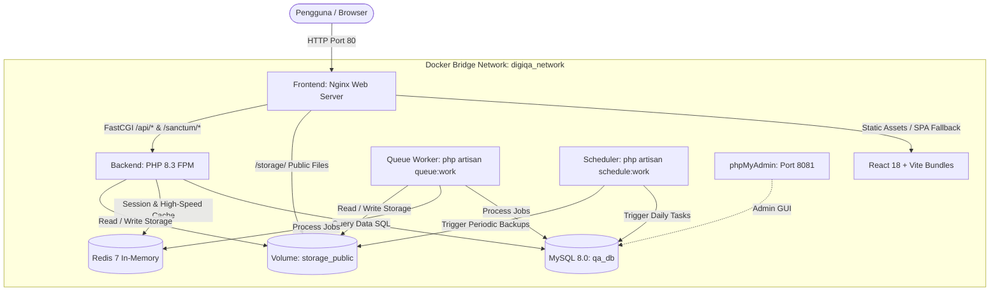

# 🐳 Panduan Lengkap Deployment Docker - DigiQA Enterprise

Dokumentasi resmi arsitektur, konfigurasi, dan panduan pengoperasian kontainer Docker untuk aplikasi **DigiQA Enterprise** (Contact Center Quality Assurance & Monitoring System).

---

## 🏗️ 1. Arsitektur Kontainer & Topologi Jaringan

DigiQA dikemas menggunakan standar arsitektur **Enterprise Multi-Container** berbasis Docker Compose dengan pola **Single-Origin Reverse Proxy**:



### Keunggulan Arsitektur Ini:
1. **Zero CORS Issues**: Browser hanya mengakses `http://localhost/` (Port 80). Permintaan API (`/api/...`) diarahkan langsung oleh Nginx ke PHP-FPM di balik layar tanpa port berbeda.
2. **Server-Sent Events (SSE) Ready**: Konfigurasi Nginx mematikan `fastcgi_buffering` untuk rute API stream sehingga modul notifikasi real-time bekerja tanpa jeda buffer.
3. **Background Job Separation**: Proses berat seperti import file Excel QSF puluhan ribu baris dan backup otomatis ke Google Drive dieksekusi secara asinkron oleh kontainer `queue` tanpa membebani respon API.
4. **Autonomous Scheduler**: Kontainer `scheduler` menjalankan cron Laravel 24/7 (Audit Harian jam 06:30, Pre-Distribution jam 06:45, dan Backup Rutin jam 01:00/02:00/03:00).

---

## 📦 2. Rincian Service Kontainer

| Service Name | Image / Base | Port Host | Fungsi & Tanggung Jawab |
| :--- | :--- | :--- | :--- |
| **`frontend`** | `nginx:alpine` (Multi-stage Node 20) | `80:80` | Menyajikan aset statis React SPA, proxy FastCGI ke backend, handle SSE, & serve direct `/storage/` |
| **`backend`** | `php:8.3-fpm-bookworm` | Internal (`9000`) | Core REST API Laravel 11/13, ekstensi GD, ZIP, PDO MySQL, Redis, OPcache, default-mysql-client |
| **`queue`** | `php:8.3-fpm-bookworm` | Internal | Worker antrean background (`php artisan queue:work --timeout=900`) |
| **`scheduler`** | `php:8.3-fpm-bookworm` | Internal | Task runner terjadwal (`php artisan schedule:work`) |
| **`db`** | `mysql:8.0` | `3306:3306` | Database utama `qa_db` dengan character set `utf8mb4` |
| **`redis`** | `redis:7-alpine` | Internal (`6379`) | Akselerasi cache memori dan sesi login pengguna |
| **`phpmyadmin`** | `phpmyadmin/phpmyadmin` | `8081:80` | Web interface administrasi basis data MySQL |

---

## 🚀 3. Panduan Cepat (Quick Start)

### A. Menjalankan di Lingkungan Windows

1. **Jalankan Docker Desktop**: Pastikan aplikasi Docker Desktop di komputer Anda telah berjalan (Status: *Engine Running*).
2. **Menjalankan Stack DigiQA**:
   - Cukup klik dua kali file **`docker_start.bat`**, ATAU
   - Buka terminal PowerShell / Command Prompt di folder project, lalu ketik:
     ```powershell
     docker compose up -d --build
     ```
3. **Inisialisasi Database (Hanya Saat Pertama Kali Deploy)**:
   - Cukup klik dua kali file **`docker_setup.bat`**, ATAU
   - Jalankan perintah:
     ```powershell
     docker compose exec backend php artisan migrate --force
     docker compose exec backend php artisan db:seed --force
     docker compose exec backend php artisan storage:link
     ```
4. **Buka Aplikasi di Browser**:
   - 🌐 **Web DigiQA Enterprise**: [http://localhost](http://localhost)
   - 🔍 **Status API Health Check**: [http://localhost/api/health](http://localhost/api/health)
   - 🗄️ **phpMyAdmin Database GUI**: [http://localhost:8081](http://localhost:8081)

5. **Menghentikan Layanan**:
   - Klik dua kali file **`docker_stop.bat`**, ATAU
     ```powershell
     docker compose down
     ```

---

### B. Menjalankan di Linux Server (Ubuntu / Debian VPS Cloud)

```bash
# 1. Masuk ke direktori project
cd /var/www/digiQa

# 2. Berikan izin eksekusi script shell
chmod +x docker_start.sh docker_stop.sh docker_setup.sh

# 3. Jalankan seluruh kontainer
./docker_start.sh

# 4. Inisialisasi database dan master seeder
./docker_setup.sh
```

---

## 🔑 4. Akun Login Default Sistem

Setelah menjalankan `docker_setup.bat` atau seeder master, akun default berikut langsung siap digunakan:

| Role | Username | Password Default | Hak Akses |
| :--- | :--- | :--- | :--- |
| **Supervisor (Root)** | `supervisor` | `password` | Akses penuh ke seluruh modul 1–9, upload QSF, auto distribution, naker, & backup |
| **Quality Assurance** | Disinkronkan via Master NAKER / User Management | Akses Lembar Sampling QA & Rekap Nilai |
| **Team Leader (TL)** | Disinkronkan via Master NAKER / User Management | Blind Audit View (Nama QA terproteksi) |

---

## ⚙️ 5. Penjelasan File Konfigurasi `.env.docker`

File `.env.docker` dibuat otomatis dari `.env.docker.example` saat stack pertama kali dijalankan. Berikut parameter penting:

```dotenv
# Pengaturan Port HTTP Aplikasi
APP_PORT=80
APP_URL=http://localhost

# Kredensial MySQL Internal Docker
DB_CONNECTION=mysql
DB_HOST=db
DB_PORT=3306
DB_DATABASE=qa_db
DB_USERNAME=digiqa_user
DB_PASSWORD=digiqa_secret_pass
DB_ROOT_PASSWORD=digiqa_root_secret_pass

# Driver Akselerasi
CACHE_STORE=redis
SESSION_DRIVER=redis
QUEUE_CONNECTION=database
REDIS_HOST=redis
REDIS_PORT=6379

# Port phpMyAdmin
PMA_PORT=8081
```

> [!NOTE]
> Jika port `80` atau `3306` pada komputer host Anda sudah digunakan oleh aplikasi lain (seperti Apache XAMPP lokal), Anda dapat mengubah variabel `APP_PORT=8080` atau `DB_PORT=3307` di file `.env.docker` tanpa merusak jaringan internal Docker.

---

## 🛠️ 6. Perintah Operasional Penting (Cheat Sheet)

### Memantau Log Kontainer Secara Real-time:
```bash
# Log seluruh service
docker compose logs -f

# Log khusus backend Laravel
docker compose logs -f backend

# Log antrean background (queue worker)
docker compose logs -f queue

# Log tugas cron terjadwal (scheduler)
docker compose logs -f scheduler
```

### Masuk ke Shell Kontainer:
```bash
# Shell interaktif di backend PHP
docker compose exec backend bash

# Shell interaktif di database MySQL
docker compose exec db mysql -u digiqa_user -p qa_db
```

### Menjalankan Perintah Artisan Manual:
```bash
# Jalankan simulasi distribusi harian
docker compose exec backend php artisan sampling:distribute-daily

# Trigger backup manual ke Google Drive
docker compose exec backend php artisan backup:system all

# Membersihkan cache aplikasi
docker compose exec backend php artisan optimize:clear
```

### Mencadangkan (Backup) & Memulihkan (Restore) Database Docker:
```bash
# Ekspor database qa_db ke file lokal
docker compose exec -T db mysqldump -u root -pdigiqa_root_secret_pass qa_db > backup_qa_db.sql

# Impor/Restore file SQL ke database Docker
docker compose exec -T db mysql -u root -pdigiqa_root_secret_pass qa_db < backup_qa_db.sql
```

---

## 🛡️ 7. Kepatuhan Aturan Bisnis & Blind Audit

Seluruh konfigurasi Docker ini sepenuhnya mematuhi aturan arsitektur di [AGENTS.md](file:///c:/xampp/htdocs/digiQa/AGENTS.md):
- **Blind Audit Protection**: Identitas QA Evaluator tetap terlindungi saat dieksekusi di backend container untuk role TL, Trainer, dan Agent.
- **SLA & Backup Safety**: Worker container dilengkapi timeout 900 detik (15 menit) untuk menjamin proses backup ke Google Drive dan eksport file besar tidak terputus di tengah jalan.
