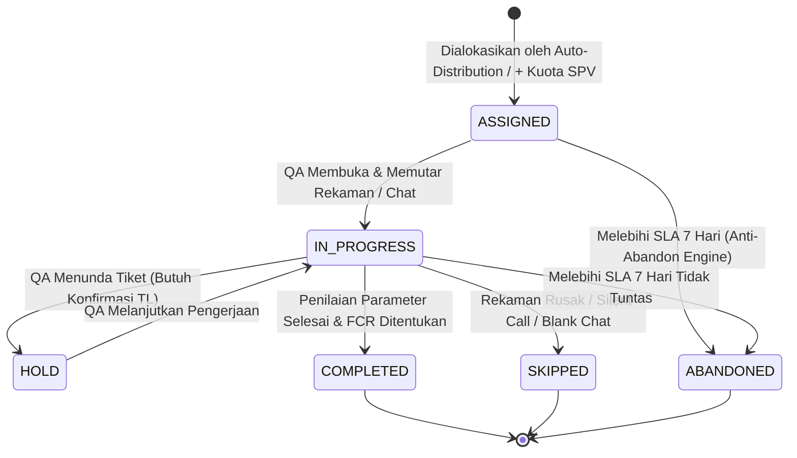
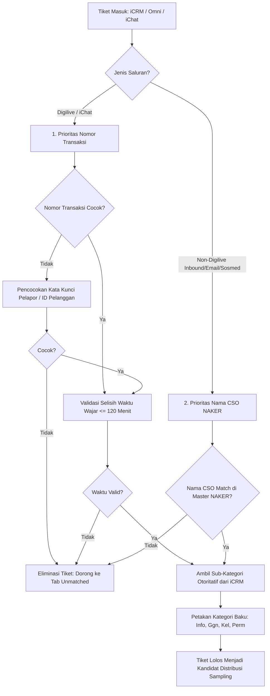
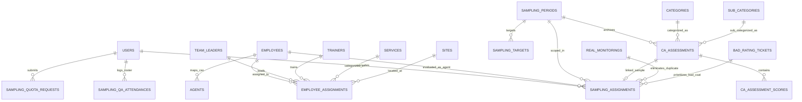

# 📘 FUNCTIONAL REQUIREMENTS DOCUMENT (FRD)
# SISTEM DIGIQA ENTERPRISE (Q-APPS CONTACT CENTER MUTU v2.0)

> **Status Dokumen**: Final Release / Production Ready  
> **Versi Dokumen**: 2.4.0  
> **Tanggal Rilis**: 13 November 2026  
> **Klasifikasi**: Dokumen Teknis & Spesifikasi Fungsional Perangkat Lunak  
> **Target Pengguna**: System Architect, Software Engineer, Quality Assurance Tester, Project Manager, dan Stakeholder Tata Kelola Mutu Contact Center.

---

## 📑 DAFTAR ISI

1. [BAB I: PENDAHULUAN & ARSITEKTUR UTAMA](#bab-i-pendahuluan--arsitektur-utama)
   - 1.1 Latar Belakang & Tujuan Sistem
   - 1.2 Prinsip Inti: Pemisahan Data Mentah vs. Data Matang
   - 1.3 Prinsip Keamanan: Blind Audit QA Evaluator
   - 1.4 Diagram Arsitektur & Pipeline Alur Data
2. [BAB II: MATRIKS PENGGUNA & HAK AKSES (RBAC)](#bab-ii-matriks-pengguna--hak-akses-rbac)
   - 2.1 Definisi Peran (Roles)
   - 2.2 Matriks Hak Akses Modul & Tindakan (CRUD Matrix)
   - 2.3 Keamanan Sesi, Heartbeat & Route Guard
3. [BAB III: SPESIFIKASI MODUL & KEBUTUHAN FUNGSIONAL DETAIL](#bab-iii-spesifikasi-modul--kebutuhan-fungsional-detail)
   - 3.1 Modul 0: Autentikasi, Profil & Keamanan
   - 3.2 Modul 1: Dashboard Global (KPI Makro CA & FCR)
   - 3.3 Modul 2: Analisis & Evaluasi Mutu (Anev Ranking CSO)
   - 3.4 Modul 3: Rekap Nilai Agent (Scorecard Pembinaan Mutu)
   - 3.5 Modul 4: Pencapaian Tim QA & Trainer (Success Board Target 370 Sesi)
   - 3.6 Modul 5: Repositori Kebijakan & Kalibrasi Mutu (Policy Hub)
   - 3.7 Modul 6: Lembar Sampling QA (Worksheet Penilaian Interaksi)
   - 3.8 Modul 7: Real Monitoring Engine (Observasi Langsung & Eliminasi)
   - 3.9 Modul 8: Under Team Rekap (Portal Monitoring Tim Binaan TL & Trainer)
   - 3.10 Modul 9: Auto Distribution Engine V2 (Distribusi Data Mentah Sampling)
   - 3.11 Modul 10: Input, Import & Data Master (Satu Pintu Data Matang & NAKER)
   - 3.12 Modul 11: Kelola Akun Pengguna & Injeksi Akun NAKER
   - 3.13 Modul 12: Backup Engine & Integrasi Google Drive
4. [BAB IV: STANDAR PARAMETER SOP PENILAIAN CA & FCR (7 SALURAN)](#bab-iv-standar-parameter-sop-penilaian-ca--fcr-7-saluran)
   - 4.1 Kanal Digilive (MyIcon+ / iChat) - 18 Parameter
   - 4.2 Kanal Inbound Call (123) - 14 Parameter
   - 4.3 Kanal Email Inbound - 15 Parameter
   - 4.4 Kanal Social Media (DM & Mention) - 8 Parameter
   - 4.5 Kanal Outbound Call (OBC) - 12 Parameter
   - 4.6 Kanal Email Outbound - 15 Parameter
   - 4.7 Kanal Back Office (BO) - 3 Parameter
5. [BAB V: ATURAN BISNIS, FORMULA & LOGIKA ALGORITMA (RULES DICTIONARY)](#bab-v-aturan-bisnis-formula--logika-algoritma-rules-dictionary)
   - 5.1 Aturan Baku KETAT H-1 (Strict H-1 Rule)
   - 5.2 Algoritma Tri-Matching (iCRM vs. Omni vs. iChat) & Validasi Time Window
   - 5.3 Aturan Anti-Tabrakan & Kuota Agent (Rolling 30 Hari)
   - 5.4 Aturan Tambahan Kuota SPV (+ Kuota SPV, Validitas 24 Jam)
   - 5.5 Aturan Kedisiplinan SLA 7 Hari (Anti-Abandon Engine)
   - 5.6 Formula Perhitungan Mutu: CA, FCR, dan Target Sesi
6. [BAB VI: SPESIFIKASI BASIS DATA & RELASI ENTITAS (DATABASE ERD)](#bab-vi-spesifikasi-basis-data--relasi-entitas-database-erd)
   - 6.1 Diagram Hubungan Entitas (ERD)
   - 6.2 Kamus Data Tabel Utama
7. [BAB VII: SPESIFIKASI API BACKEND (ENDPOINTS & CONTRACT)](#bab-vii-spesifikasi-api-backend-endpoints--contract)
8. [BAB VIII: KEBUTUHAN NON-FUNGSIONAL (NFR) & KEANDALAN SISTEM](#bab-viii-kebutuhan-non-fungsional-nfr--keandalan-sistem)

---

# BAB I: PENDAHULUAN & ARSITEKTUR UTAMA

## 1.1 Latar Belakang & Tujuan Sistem
**DigiQA Enterprise** adalah sistem perangkat lunak tata kelola mutu (*Quality Assurance Governance*) yang dibangun khusus untuk operasional Contact Center berskala enterprise. Sistem ini mengintegrasikan seluruh tahapan pemantauan mutu layanan pelanggan, mulai dari penarikan data transaksi pelanggan mentah (dari iCRM, Omni Channel, dan iChat), pembagian sampling harian otomatis, lembar kerja penilaian parameter SOP berbasis audio dan percakapan teks, audit disiplin pengerjaan antrean berbatas waktu (SLA 7 Hari), hingga penyajian dasbor analitik eksekutif bulanan (Customer Accuracy/CA dan First Contact Resolution/FCR).

Tujuan utama pembangunan sistem:
1. Menghilangkan bias manual dan subjektivitas dalam pengambilan sampel interaksi agen (*zero favoritism sampling*).
2. Memastikan seluruh 7 Layanan Baku Contact Center (Inbound, Email, Digi DM, Sosmed, MyIcon, Outbond, dan Back Office) serta 4 Kategori Tiket (Informasi, Gangguan, Keluhan, Permohonan) tersampling secara proporsional.
3. Menjamin perlindungan integritas evaluasi melalui prinsip *Blind Audit*.
4. Mengamankan kontinuitas data mutu melalui pencadangan berkala otomatis ke Google Drive.

---

## 1.2 Prinsip Inti: Pemisahan Data Mentah vs. Data Matang
DigiQA menerapkan pemisahan logika dan penyimpanan yang ketat (*Strict Data Separation Rule*) antara **Data Mentah Operasional Harian** dan **Data Matang Dasbor Eksekutif**:

```
┌─────────────────────────────────────────────────────────────────────────────────────────────┐
│ 1. DATA MENTAH (RAW SAMPLING DATA)                                                          │
│ - Sumber: Berkas ekspor transaksi mentah CRM/Omni/iChat (62 Kolom).                         │
│ - Lokasi Modul: Modul 9 (Auto Distribution) & Modul 6 (Lembar Sampling QA).                │
│ - Karakteristik: Belum memiliki skor CA, status FCR, maupun catatan coaching.               │
│ - Siklus Operasional: Diimpor harian pada pagi hari (< 07:00 WIB), dibagi ke 8 QA On Duty,  │
│   dan sisa ribuan transaksi ditampung di Pool Cadangan Mentah untuk + Kuota SPV.            │
└─────────────────────────────────────────────────────────────────────────────────────────────┘
                                      │
                                      ▼ (Dievaluasi oleh QA Evaluator)
┌─────────────────────────────────────────────────────────────────────────────────────────────┐
│ 2. DATA MATANG (PROCESSED QSF DATA)                                                         │
│ - Sumber: Berkas Rekapitulasi QSF Final 7 Saluran yang telah dinilai 100% oleh QA.         │
│ - Lokasi Modul: Modul 10 (Input & Import Data Master) -> Modul 1 s/d 4 (Executive Dashboard)│
│ - Karakteristik: Memiliki skor CA definitif (0–100%), status FCR (YA/TIDAK), dan parameter. │
│ - Siklus Pelaporan: Diimpor pada awal bulan berikutnya (tgl 1–3) untuk mengunci KPI resmi. │
└─────────────────────────────────────────────────────────────────────────────────────────────┘
```

> [!IMPORTANT]
> **Aturan Arsitektur Kritis**: Data mentah pada Auto Distribution **DILARANG KERAS** langsung diproyeksikan ke Dashboard Global (Modul 1–4) sebelum melalui observasi tuntas di Lembar Sampling QA (Modul 6) dan diimpor sebagai berkas QSF resmi melalui Modul 10.

---

## 1.3 Prinsip Keamanan: Blind Audit QA Evaluator
Untuk menjaga objektivitas, mencegah intimidasi, dan menghindari potensi friksi antar-divisi, sistem menerapkan aturan **Blind Audit**:
1. Pengguna dengan peran **Team Leader (TL)**, **Trainer QA**, dan **Agent (CSO)** **DILARANG KERAS** melihat identitas atau nama QA Evaluator yang menilai tiket CSO binaannya.
2. Pada seluruh antarmuka (Lembar Sampling QA, Rekap Nilai Agent, Under Team Rekap, laporan unduhan, ekspor Excel, ekspor PDF, serta *payload response* RESTful API backend), identitas QA Evaluator wajib di-masking/disamarkan menjadi:
   - `QA Evaluator (Terproteksi)` atau `Terproteksi (Blind Audit)`.
3. Hanya pengguna dengan peran **Supervisor**, **Superadmin / Admin**, dan **QA Evaluator yang menilai tiket bersangkutan** yang berhak melihat nama asli evaluator.

---

## 1.4 Diagram Arsitektur & Pipeline Alur Data

```mermaid
flowchart TD
    subgraph Data Sources
        SRC_CRM[Berkas Transaksi iCRM 62 Kolom]
        SRC_OMNI[Tarikan Omni Channel Summary]
        SRC_ICHAT[Ekspor Percakapan iChat / Digilive]
        SRC_NAKER[Master Database NAKER Plotting]
    end

    subgraph Modul 9: Auto Distribution Engine V2
        IMP_RAW[Upload Berkas Mentah & Normalisasi Nama]
        TRI_MATCH[Tri-Matching Engine: No Transaksi & Nama CSO]
        FILTER_H1[Strict H-1 Rule & Eliminasi Unmatched]
        POOL_BUFFER[(Pool Cadangan Data Mentah)]
        ROSTER_QA{Roster QA: On Duty?}
        DIST_ENGINE[Mesin Distribusi 7 Layanan & 4 Kategori]
    end

    subgraph Modul 6: Lembar Sampling QA
        QA_QUEUE[Antrean Tiket QA Evaluator: Masuk Hari Ini]
        QA_EVAL[Observasi SOP, Audio Player, Chat Viewer, Scoring CA & FCR]
        QA_ACTION{Aksi QA}
        ST_DONE[Status: COMPLETED Data Matang]
        ST_HOLD[Status: HOLD Konfirmasi]
        ST_SKIP[Status: SKIPPED Blank/Audio Rusak]
        ST_EXPIRE[SLA 7 Hari Expired: ABANDONED]
    end

    subgraph Modul 10: Satu Pintu Data Matang
        EXP_QSF[Export Berkas QSF Bulanan 7 Kanal]
        IMP_QSF[Import QSF Matang Awal Bulan]
        DB_OFFICIAL[(Database Mutu Resmi CA & FCR)]
    end

    subgraph Modul 1-4: Dasbor Eksekutif
        M1[Modul 1: Dashboard Global KPI CA & FCR]
        M2[Modul 2: Analisis & Evaluasi Anev Ranking]
        M3[Modul 3: Rekap Nilai Agent Scorecard]
        M4[Modul 4: Pencapaian Tim QA Target 370]
    end

    SRC_CRM --> IMP_RAW
    SRC_OMNI --> IMP_RAW
    SRC_ICHAT --> IMP_RAW
    SRC_NAKER --> Modul 10
    
    IMP_RAW --> TRI_MATCH
    TRI_MATCH --> FILTER_H1
    FILTER_H1 --> POOL_BUFFER
    POOL_BUFFER --> DIST_ENGINE
    ROSTER_QA --> DIST_ENGINE
    
    DIST_ENGINE --> QA_QUEUE
    QA_QUEUE --> QA_EVAL
    QA_EVAL --> QA_ACTION
    
    QA_ACTION -->|Selesai Dinilai| ST_DONE
    QA_ACTION -->|Perlu Konfirmasi| ST_HOLD
    QA_ACTION -->|File Rusak/Silent| ST_SKIP
    QA_ACTION -->|> 7 Hari Tidak Dikerjakan| ST_EXPIRE
    
    ST_DONE --> EXP_QSF
    EXP_QSF --> IMP_QSF
    IMP_QSF --> DB_OFFICIAL
    
    DB_OFFICIAL --> M1
    DB_OFFICIAL --> M2
    DB_OFFICIAL --> M3
    DB_OFFICIAL --> M4
```

---

# BAB II: MATRIKS PENGGUNA & HAK AKSES (RBAC)

## 2.1 Definisi Peran (Roles)
Sistem memiliki 6 level pengguna:
1. **Superadmin (`superadmin`)**: Pemilik hak akses tertinggi terhadap seluruh modul, konfigurasi infrastruktur, audit log, manipulasi akun, dan Google Drive Backup.
2. **Supervisor QA (`supervisor` / `admin`)**: Pengendali operasional mutu harian. Berwenang mengunggah tarikan CRM, mengeksekusi Auto-Distribution, memberikan `+ Kuota SPV`, mereassign tiket, mengelola Master NAKER, dan mengimpor QSF bulanan.
3. **QA Evaluator (`quality_assurance` / `qa`)**: Penilai mutu interaksi agen. Menerima tiket sampling harian (10–13 tiket/hari), mengisi lembar penilaian SOP, menentukan FCR, dan mengajukan kuota ekstra jika kuota harian selesai.
4. **Team Leader (`team_leader` / `tl`)**: Pembina kelompok agen CSO. Memantau progres nilai dan deviasi parameter tim binaannya, melakukan sesi coaching 1-on-1, dan mengunduh kartu nilai (Scorecard) agen. Identitas QA Evaluator disamarkan.
5. **Trainer QA (`trainer` / `trn`)**: Penanggung jawab pelatihan dan kalibrasi mutu. Menganalisis parameter terendah (gap analysis), mengevaluasi ranking Anev, dan mengunggah notulensi kalibrasi di Policy Hub. Identitas QA Evaluator disamarkan.
6. **Agent / CSO (`agent` / `cso`)**: Petugas layanan front-liner yang dinilai. Dapat melihat rekap performa nilai pribadinya secara mandiri (*self-monitoring*). Identitas QA Evaluator disamarkan.

---

## 2.2 Matriks Hak Akses Modul & Tindakan (CRUD Matrix)

| Modul | Nama Modul / URL | Superadmin | Supervisor | QA Evaluator | Team Leader | Trainer | Agent / CSO |
|---|---|:---:|:---:|:---:|:---:|:---:|:---:|
| **Modul 0** | Login & Profil (`/login`, `/me`) | CRUD | CRUD | CRUD | CRUD | CRUD | RU |
| **Modul 1** | Dashboard Global (`/dashboard-global`) | CRUD | CRUD | R | R | R | R (Pribadi) |
| **Modul 2** | Anev Ranking (`/anev`) | CRUD | CRUD | R | R (Tim) | R | - |
| **Modul 3** | Rekap Nilai Agent (`/rekap-agent`) | CRUD | CRUD | R (Blind) | R (Tim-Blind) | R (Blind) | R (Pribadi-Blind) |
| **Modul 4** | Pencapaian QA (`/pencapaian-qa`) | CRUD | CRUD | R (Pribadi) | - | - | - |
| **Modul 5** | QA Policy Hub (`/kebijakan`) | CRUD | CRUD | CR (Tanya) | R | CR (Kalibrasi)| R |
| **Modul 6** | Lembar Sampling (`/evaluasi-sampling`)| CRUD | R (Audit) | CRUD (Work) | - | - | - |
| **Modul 7** | Real Monitoring (`/real-monitoring`) | CRUD | R (Monitor) | CRUD (Input) | - | - | - |
| **Modul 8** | Under Team Rekap (`/rekap-under-team`)| CRUD | R | - | CRUD (Tim) | CRUD (Binaan)| - |
| **Modul 9** | Auto Distribution (`/auto-distribution`)| CRUD | CRUD (Eksekusi)| R (Bucket) | R (Pantau Tim) | - | - |
| **Modul 10**| Data Master & Import (`/settings`) | CRUD | CRUD | - | R (Plotting) | R (Plotting) | - |
| **Modul 11**| Kelola Akun (`/kelola-akun`) | CRUD | CRUD (Terbatas)| - | - | - | - |
| **Modul 12**| Backup Drive (`/backup-drive`) | CRUD | CRUD | - | - | - | - |

*Keterangan: C = Create, R = Read, U = Update, D = Delete, Blind = Nama Evaluator Disamarkan.*

---

## 2.3 Keamanan Sesi, Heartbeat & Route Guard
- **Token Bearer**: Autentikasi berbasis Laravel Sanctum dengan token tersimpan di browser cookie (`token`, `auth_token`, `access_token`) berstatus HTTP-only / SameSite-Lax.
- **Heartbeat Daemon**: Setiap 45 detik, frontend mengirim `POST /api/user/heartbeat` untuk memperbarui status aktivitas pengguna. Jika tidak ada aktivitas selama 15 menit, sesi dinyatakan idle.
- **Route Guards (Frontend `App.jsx`)**:
  - `ProtectedRoute`: Memastikan pengguna telah terautentikasi sebelum merender layout utama.
  - `SupervisorRoute`: Membatasi akses khusus peran Supervisor/Superadmin (Auto-Distribution, Settings, User Management, Backup Management, Riwayat NAKER).
  - `SamplingRoute`: Membatasi akses lembar sampling hanya untuk QA Evaluator dan Supervisor.
  - `UnderTeamRoute`: Mengarahkan Team Leader dan Trainer ke portal rekapitulasi tim binaan.

---

# BAB III: SPESIFIKASI MODUL & KEBUTUHAN FUNGSIONAL DETAIL

## 3.1 Modul 0: Autentikasi, Profil & Keamanan
- **Fungsi**: Gerbang masuk pengguna, verifikasi NIK/Username dan Password, pemilihan peran dinamis, dan pembaruan kredensial mandiri.
- **Alur Login**:
  1. Pengguna memasukkan `username` (atau NIK) dan `password`.
  2. Backend mencocokkan hash password (`Bcrypt`).
  3. Mengembalikan objek user, token autentikasi, serta status peran.
- **File Terkait**:
  - Backend: [AuthController.php](file:///c:/xampp/htdocs/digiQa/backend/app/Http/Controllers/Api/AuthController.php)
  - Frontend: [Login.jsx](file:///c:/xampp/htdocs/digiQa/frontend/src/pages/Login.jsx), [AuthContext.jsx](file:///c:/xampp/htdocs/digiQa/frontend/src/context/AuthContext.jsx)

---

## 3.2 Modul 1: Dashboard Global (KPI Makro CA & FCR)
- **Fungsi**: Menyajikan ringkasan kinerja mutu tingkat site (makro) secara komprehensif.
- **Metrik Utama**:
  1. **Skor Rata-Rata CA**: Persentase kepatuhan SOP seluruh transaksi pada periode terpilih (Target Standar $\ge 85.00\%$).
  2. **Skor Rata-Rata FCR**: Persentase penyelesaian masalah pada kontak pertama (Target Standar $100.00\%$).
  3. **Grafik Tren Bulanan (Jan – Des)**: Visualisasi fluktuasi skor CA dan FCR per bulan.
  4. **Distribusi Kinerja Saluran**: Breakdown skor CA/FCR pada 7 saluran layanan.
  5. **5 Parameter Terendah**: Identifikasi titik kritis kegagalan parameter mutu untuk kebutuhan penyusunan materi retraining.
- **File Terkait**:
  - Backend: [DashboardController.php](file:///c:/xampp/htdocs/digiQa/backend/app/Http/Controllers/Api/DashboardController.php#L23) (`globalDashboard`)
  - Frontend: [GlobalDashboard.jsx](file:///c:/xampp/htdocs/digiQa/frontend/src/pages/GlobalDashboard.jsx)

---

## 3.3 Modul 2: Analisis & Evaluasi Mutu (Anev Ranking CSO)
- **Fungsi**: Pemeringkatan kinerja agen CSO berdasarkan pencapaian skor CA dan pemenuhan FCR.
- **Komponen Fungsional**:
  1. **Top 5 & Top 10 High Performers**: Daftar agen dengan skor CA tertinggi untuk program apresiasi.
  2. **Bottom 5 & Bottom 10 Low Performers**: Daftar agen dengan skor CA terendah untuk prioritas pembinaan (Coaching).
  3. **Deviasi Parameter Mutu**: Deteksi parameter spesifik yang paling sering dilanggar oleh bottom agents.
  4. **Filter Cerdas**: Filter berdasarkan Periode Bulan, Layanan/Saluran, dan Site (Semarang/Jakarta).
- **File Terkait**:
  - Backend: [DashboardController.php](file:///c:/xampp/htdocs/digiQa/backend/app/Http/Controllers/Api/DashboardController.php#L75) (`anevRanking`)
  - Frontend: [AnevRanking.jsx](file:///c:/xampp/htdocs/digiQa/frontend/src/pages/AnevRanking.jsx)

---

## 3.4 Modul 3: Rekap Nilai Agent (Scorecard Pembinaan Mutu)
- **Fungsi**: Lembar rekapitulasi nilai individual agen secara rinci per sesi interaksi.
- **Fitur Utama**:
  1. **Pencarian Agen**: Berdasarkan Nama CSO, NIK, atau ID Tiket CRM.
  2. **Detail Skor Parameter**: Modal inspeksi yang menampilkan nilai setiap poin parameter SOP (skor 0 atau bobot penuh).
  3. **Catatan Coaching**: Menampilkan catatan perbaikan dan feedback dari QA Evaluator.
  4. **Ekspor Laporan**: Tombol ekspor data ke format **Excel (.xlsx)** dan **Cetak PDF Lembar Observasi**.
  5. **Enforcement Blind Audit**: Kolom nama QA evaluator wajib tertulis `QA Evaluator (Terproteksi)` saat diakses oleh TL, Trainer, maupun Agent.
- **File Terkait**:
  - Backend: [AgentRecapController.php](file:///c:/xampp/htdocs/digiQa/backend/app/Http/Controllers/Api/AgentRecapController.php)
  - Frontend: [AgentRecap.jsx](file:///c:/xampp/htdocs/digiQa/frontend/src/pages/AgentRecap.jsx)

---

## 3.5 Modul 4: Pencapaian Tim QA & Trainer (Success Board)
- **Fungsi**: Memantau progres realisasi target sampling bulanan tim QA dan Trainer.
- **Aturan Target Sesi**:
  - Target Bulanan per QA: **370 Sesi/Bulan** (terdiri dari **346 Sesi Mandatory** dan **24 Sesi Buffer/Tambahan**).
  - Target Bulanan Tim Site (8 QA): **2.960 Sesi/Bulan**.
- **Indikator Progres**:
  - Progress bar pencapaian kuota aktual terhadap target.
  - Sisa hari kerja dan kecepatan rata-rata harian yang dibutuhkan (*required run rate*).
- **File Terkait**:
  - Backend: [EvaluatorSamplingController.php](file:///c:/xampp/htdocs/digiQa/backend/app/Http/Controllers/Api/EvaluatorSamplingController.php)
  - Frontend: [QATrainerSampling.jsx](file:///c:/xampp/htdocs/digiQa/frontend/src/pages/QATrainerSampling.jsx)

---

## 3.6 Modul 5: Repositori Kebijakan & Kalibrasi Mutu (Policy Hub)
- **Fungsi**: *Knowledge base* regulasi SOP, standar parameter, dan repositori notulensi rapat kalibrasi mutu berkala.
- **Fitur Utama**:
  1. Pengelompokan kategori kebijakan: *Billing*, *Technical*, *Operational*, *General*.
  2. Unggah lampiran dokumen resmi (PDF, Word, Excel).
  3. Forum diskusi/tanya jawab per kebijakan antara Trainer, QA, dan Supervisor.
- **File Terkait**:
  - Backend: [PolicyDiscussionController.php](file:///c:/xampp/htdocs/digiQa/backend/app/Http/Controllers/Api/PolicyDiscussionController.php)
  - Frontend: [PolicyRepository.jsx](file:///c:/xampp/htdocs/digiQa/frontend/src/pages/PolicyRepository.jsx)

---

## 3.7 Modul 6: Lembar Sampling QA (Worksheet Penilaian Interaksi)
- **Fungsi**: Antarmuka kerja operasional harian bagi QA Evaluator untuk menilai sampel tiket.
- **Alur Kerja Penilaian**:



- **Fitur Lembar Penilaian**:
  1. **Tab Antrean Tiket**: Memisahkan tiket "Masuk Hari Ini" (*indikator biru*) dan "Tiket Menumpuk / Backlog" (*indikator amber*).
  2. **Pemutar Rekaman & Transkrip Chat**: Integrasi URL rekaman audio Inbound/Outbound dan riwayat teks chat iChat/Omni.
  3. **Matriks Penilaian Parameter**: Checkbox otomatis per parameter sesuai kanal tiket yang dinilai (Digilive, Inbound, Sosmed, dll).
  4. **Pilihan FCR**: Tombol radio eksplisit `YA` (Tuntas kontak pertama) atau `TIDAK` (Perlu eskalasi).
  5. **Catatan Coaching**: Area teks wajib diisi jika terdapat parameter yang bernilai 0 atau tidak patuh.
  6. **Permintaan Tambah Kuota**: Tombol `+ Ajukan Kuota (+10 Tiket)` yang aktif ketika seluruh kuota harian telah berstatus `COMPLETED`.
- **File Terkait**:
  - Backend: [SamplingDistributionController.php](file:///c:/xampp/htdocs/digiQa/backend/app/Http/Controllers/Api/SamplingDistributionController.php)
  - Frontend: [QASamplingWorksheet.jsx](file:///c:/xampp/htdocs/digiQa/frontend/src/pages/QASamplingWorksheet.jsx)

---

## 3.8 Modul 7: Real Monitoring Engine (Observasi Langsung & Eliminasi)
- **Fungsi**: Mendukung kegiatan observasi interaksi agen secara langsung (*live listening / side-by-side coaching*) dan mengintegrasikannya dengan mesin distribusi sampling.
- **Logika Eliminasi Silang**:
  - Tiket yang telah diobservasi pada Real Monitoring menghasilkan kunci unik eliminasi (`no_icrm`, `no_transaksi`, `no_omni`, `no_ichat`).
  - Mesin Auto Distribution secara otomatis mendeteksi kunci ini dan **mengeliminasi tiket tersebut dari sampling**, mencegah seorang agen dinilai dua kali untuk interaksi yang sama.
- **File Terkait**:
  - Backend: [RealMonitoringController.php](file:///c:/xampp/htdocs/digiQa/backend/app/Http/Controllers/Api/RealMonitoringController.php)
  - Frontend: [RealMonitoring.jsx](file:///c:/xampp/htdocs/digiQa/frontend/src/pages/RealMonitoring.jsx)

---

## 3.9 Modul 8: Under Team Rekap (Portal Tim Binaan TL & Trainer)
- **Fungsi**: Portal khusus bagi Team Leader dan Trainer untuk memonitor hasil observasi agen binaan mereka.
- **Fitur Utama**:
  1. Menampilkan daftar tiket sampling milik agen yang berada di bawah kepengawasan TL/Trainer yang bersangkutan.
  2. Filter berdasarkan Saluran (Inbound, Digilive, Email, Sosmed, Outbound, BO).
  3. Unduh berkas rekapitulasi nilai tim binaan.
  4. Penegakan protokol *Blind Audit* (identitas QA disamarkan).
- **File Terkait**:
  - Frontend: [UnderTeamRekap.jsx](file:///c:/xampp/htdocs/digiQa/frontend/src/pages/UnderTeamRekap.jsx)

---

## 3.10 Modul 9: Auto Distribution Engine V2 (Pusat Distribusi Data Mentah Sampling)
- **Fungsi**: Jantung otomatisasi sistem yang memproses transaksi mentah pelanggan, melakukan pencocokan relasi (*Tri-Matching*), memvalidasi aturan H-1, membagi kuota seimbang, dan mengelola pool cadangan.
- **Komposisi Default 7 Layanan Baku (13 Tiket / QA / Hari)**:
  1. `INBOUND` : 2 Tiket
  2. `EMAIL` : 1 Tiket
  3. `DIGI DM` : 2 Tiket
  4. `SOSMED` : 2 Tiket
  5. `MYICON` : 2 Tiket
  6. `OUTBOND` : 2 Tiket
  7. `BACK OFFICE` : 2 Tiket
- **Komposisi Default 4 Kategori Baku (13 Tiket / QA / Hari)**:
  1. `INFORMASI` : 4 Tiket
  2. `GANGGUAN` : 3 Tiket
  3. `KELUHAN` : 5 Tiket
  4. `PERMOHONAN` : 1 Tiket
- **Kustomisasi Mandiri Bebas Auto-Rebalance**:
  - Supervisor dapat mengatur target kuota layanan (misal 10 tiket) dan target kategori (misal 13 tiket) secara **100% independen tanpa auto-scaling**. Mode tab yang aktif saat tombol ditekan menentukan total kuota yang dialokasikan.
- **Roster Kesiapan QA (Daily Attendance & Readiness)**:
  - QA dapat mengubah status harian: `ON_DUTY` (Ready), `OFF_DAY` (Libur), atau `END_SHIFT` (Shift Selesai).
  - Distribusi hanya membagikan tiket kepada QA yang berstatus `ON_DUTY`. Jika belum ada QA yang ON DUTY, sistem secara cerdas menggunakan fallback ke seluruh QA aktif terdaftar agar distribusi tidak mandek.
- **File Terkait**:
  - Backend: [AutoDistributionEngineService.php](file:///c:/xampp/htdocs/digiQa/backend/app/Services/Sampling/AutoDistributionEngineService.php), [SamplingDistributionController.php](file:///c:/xampp/htdocs/digiQa/backend/app/Http/Controllers/Api/SamplingDistributionController.php)
  - Frontend: [AutoDistribution.jsx](file:///c:/xampp/htdocs/digiQa/frontend/src/pages/AutoDistribution.jsx)

---

## 3.11 Modul 10: Input, Import & Data Master (Satu Pintu Data Matang & NAKER)
- **Fungsi**: Mengelola master database tenaga kerja dan pintu masuk tunggal data resmi bulanan.
- **Sub-Fungsi**:
  1. **Master Data NAKER (Plotting)**: Mengimpor struktur organisasi agen (Nama CSO, NIK, Jabatan, Team Leader, Trainer, Site, Saluran kerja) dari file Excel `DATA_NAKER_BULANAN.xlsx` sheet `PLOTTING`.
  2. **Pembersihan Nama CSO (`cleanCsoName`)**: Mengikis prefix operasional teknis seperti `KOOPS.02`, `OB.01`, `CSO.01`, `SMG-`, `JKT-`, dll., menjadi nama asli agen secara konsisten.
  3. **Impor Berkas QSF Matang**: Mengimpor hasil sampling final 7 saluran per awal bulan untuk mengkalkulasi metrik resmi pada Dashboard 1–4.
  4. **Setup Formula Mutu**: Mengonfigurasi formula bobot parameter SOP.
- **File Terkait**:
  - Backend: [NakerImportService.php](file:///c:/xampp/htdocs/digiQa/backend/app/Services/NakerImportService.php), [QsfImportService.php](file:///c:/xampp/htdocs/digiQa/backend/app/Services/QsfImportService.php)
  - Frontend: [SupervisorInput.jsx](file:///c:/xampp/htdocs/digiQa/frontend/src/pages/SupervisorInput.jsx), [Settings.jsx](file:///c:/xampp/htdocs/digiQa/frontend/src/pages/Settings.jsx)

---

## 3.12 Modul 11: Kelola Akun Pengguna & Injeksi Akun NAKER
- **Fungsi**: Manajemen otorisasi pengguna dan otomatisasi sinkronisasi akun dari database NAKER.
- **Fitur Kunci**:
  1. **Injeksi Akun NAKER**: Tombol `Sinkronkan Akun dari NAKER` memindai seluruh data personil di tabel `employees` yang belum memiliki akun login dan membuatkan akun secara otomatis dengan role yang sesuai.
  2. **Reset Kredensial**: Fitur reset password instan oleh Supervisor/Admin.
  3. **Aktivasi Akun**: Mengaktifkan/menonaktifkan status akun pengguna secara real-time.
- **File Terkait**:
  - Backend: [UserController.php](file:///c:/xampp/htdocs/digiQa/backend/app/Http/Controllers/Api/UserController.php)
  - Frontend: [UserManagement.jsx](file:///c:/xampp/htdocs/digiQa/frontend/src/pages/UserManagement.jsx)

---

## 3.13 Modul 12: Backup Engine & Integrasi Google Drive
- **Fungsi**: Menjamin keamanan data mutlak melalui pencadangan berkala database dan berkas sistem ke Google Drive.
- **Fitur Utama**:
  1. **Mode Autentikasi**:
     - `oauth2`: Untuk akun Google Drive personal (kapasitas 15 GB).
     - `service_account`: Untuk Google Workspace Shared Drive perusahaan.
  2. **Jadwal Pencadangan Otomatis**: Konfigurasi frekuensi harian atau mingguan.
  3. **Pencadangan Manual**: Tombol trigger pencadangan instan satu-klik.
  4. **Audit Log Backup**: Riwayat pencadangan, ukuran file arsip, dan status unggah ke Google Drive.
- **File Terkait**:
  - Backend: [BackupSettingController.php](file:///c:/xampp/htdocs/digiQa/backend/app/Http/Controllers/Api/BackupSettingController.php), [GoogleDriveConfigService.php](file:///c:/xampp/htdocs/digiQa/backend/app/Services/GoogleDriveConfigService.php)
  - Frontend: [BackupManagement.jsx](file:///c:/xampp/htdocs/digiQa/frontend/src/pages/BackupManagement.jsx)

---

# BAB IV: STANDAR PARAMETER SOP PENILAIAN CA & FCR (7 SALURAN)

Total bobot pada setiap saluran adalah tepat **100 Poin**. Penilaian bernilai diskrit (skor 0 jika tidak dipenuhi, atau skor bobot penuh jika dipenuhi).

## 4.1 Kanal Digilive (MyIcon+ / iChat) - 18 Parameter
| Kode | Parameter Mutu | Bobot |
|:---:|:---|:---:|
| 1.1 | Menggunakan Salam Pembuka Sesuai Standar | 5 |
| 2.1 | Pemilihan Kata | 5 |
| 2.2 | Pemilihan Kalimat | 5 |
| 2.3 | Penggunaan Tanda Baca | 5 |
| 3.1 | Konfirmasi Kejelasan Informasi & Menawarkan Bantuan Berikutnya Secara Terstruktur | 5 |
| 4.1 | Menggunakan Salam Penutup Sesuai Standar | 5 |
| 5.1 | Cepat dan Tanggap Menangani Pelanggan | 5 |
| 5.2 | Proses Hold Sesuai Ketentuan | 5 |
| 5.3 | Alur Transaksi Sesuai Ketentuan | 5 |
| 6.1 | Menunjukan Empati atau Apresiasi | 5 |
| 6.2 | Etika Pelayanan | 5 |
| 7.1 | Aktif Menyebutkan Nama Pelapor | 5 |
| 8.1 | Menanyakan Permasalahan Pelanggan, Data Inti dan/atau Data Pendukung | 10 |
| 8.2 | Menanyakan Secara Terstruktur | 5 |
| 9.1 | Verifikasi Data Sesuai Tahapan & Ketentuan serta Menjaga Kerahasian Data | 10 |
| 9.2 | Akad Transaksi | 5 |
| 10.1| Ketepatan Informasi/Solusi | 5 |
| 10.2| Kesesuaian Pencatatan | 5 |
| **Total** | | **100** |

---

## 4.2 Kanal Inbound Call (123) - 14 Parameter
| Kode | Parameter Mutu | Bobot |
|:---:|:---|:---:|
| 1 | Salam Pembuka | 5 |
| 2 | Verifikasi Data Pelanggan / Konfirmasi Data Non Pelanggan | 10 |
| 3 | Menyimak Permintaan Pelanggan atau Non Pelanggan | 5 |
| 4 | Probing | 10 |
| 5 | Intonasi, Volume, Kejelasan Ucapan & Kecepatan Berbicara | 10 |
| 6 | Penggunaan Kata & Kalimat | 5 |
| 7 | Magic Word (Maaf, Tolong, Terima Kasih) | 5 |
| 8 | Akurasi Informasi / Solusi | 15 |
| 9 | Menyebut Nama Pelanggan atau Non Pelanggan | 5 |
| 10 | Akad Transaksi | 5 |
| 11 | Konfirmasi Kejelasan Informasi & Menawarkan Bantuan Berikutnya | 5 |
| 12 | Etika Berkomunikasi | 5 |
| 13 | Pencatatan CRM | 10 |
| 14 | Salam Penutup | 5 |
| **Total** | | **100** |

---

## 4.3 Kanal Email Inbound - 15 Parameter
| Kode | Parameter Mutu | Bobot |
|:---:|:---|:---:|
| 1 | Sapa nama pelanggan | 5 |
| 2 | Salam Pembuka | 5 |
| 3 | Konfirmasi Email | 5 |
| 4 | Identifikasi Email (Nomor / ID Tiket) | 5 |
| 5 | Penggunaan Bahasa yang Sesuai | 5 |
| 6 | Cara penulisan CSO dalam membalas e-mail | 10 |
| 7 | Informasi kanal lain | 5 |
| 8 | Salam penutup email | 5 |
| 9 | Emphaty / Appreciation | 5 |
| 10 | Etika / kesopanan | 5 |
| 11 | Validasi data pelanggan | 10 |
| 12 | Akad Transaksi | 5 |
| 13 | Kemampuan Probing | 10 |
| 14 | Informasi / Solusi | 15 |
| 15 | Kesesuaian Pencatatan CRM | 10 |
| **Total** | | **100** |

---

## 4.4 Kanal Social Media (DM & Mention) - 8 Parameter
| Kode | Parameter Mutu | Bobot |
|:---:|:---|:---:|
| 1 | Sapa Nama Pemilik Akun | 10 |
| 2 | Kreatifitas Kalimat | 10 |
| 3 | Kemampuan Menyimak | 15 |
| 4 | Memberikan Solusi Lengkap dan Akurat | 20 |
| 5 | Empati atau Apresiasi | 15 |
| 6 | Kemampuan Menulis | 10 |
| 7 | Melakukan Pencatatan CRM | 10 |
| 8 | Kesesuaian Pencatatan CRM | 10 |
| **Total** | | **100** |

---

## 4.5 Kanal Outbound Call (OBC) - 12 Parameter
| Kode | Parameter Mutu | Bobot |
|:---:|:---|:---:|
| 1 | Salam Pembuka | 5 |
| 2 | Verifikasi Data Pelanggan / Konfirmasi Data Non Pelanggan | 10 |
| 3 | Menyimak Informasi Pelanggan | 5 |
| 4 | Kemampuan Negosiasi atau Cara Konfirmasi | 10 |
| 5 | Intonasi, Volume, Kejelasan Ucapan & Kecepatan Berbicara | 10 |
| 6 | Penggunaan Kata & Kalimat | 5 |
| 7 | Etika Komunikasi | 5 |
| 8 | Kelengkapan Informasi | 15 |
| 9 | Menyebut Nama Pelanggan atau Non Pelanggan | 5 |
| 10 | Konfirmasi Kejelasan Informasi | 5 |
| 11 | Pencatatan CRM | 15 |
| 12 | Salam Penutup | 5 |
| **Total** | | **100** |

---

## 4.6 Kanal Email Outbound - 15 Parameter
| Kode | Parameter Mutu | Bobot |
|:---:|:---|:---:|
| 1 | Ketidaksesuaian prosedur Outbound (CSO sudah menghubungi 3x via telepon) | 10 |
| 2 | Sapa nama pelanggan | 5 |
| 3 | Salam Pembuka | 5 |
| 4 | Konfirmasi Laporan | 5 |
| 5 | Identifikasi Email (Nomor / ID Tiket) | 5 |
| 6 | Penggunaan Bahasa yang Sesuai | 5 |
| 7 | Cara penulisan CSO | 10 |
| 8 | Informasi kanal lain | 5 |
| 9 | Salam penutup email | 5 |
| 10 | Emphaty / Appreciation | 5 |
| 11 | Etika / Kesopanan | 5 |
| 12 | Validasi data pelanggan | 10 |
| 13 | Kelengkapan Informasi / Solusi | 10 |
| 14 | Pencatatan CRM | 10 |
| 15 | Kesesuaian pengisian CRM | 5 |
| **Total** | | **100** |

---

## 4.7 Kanal Back Office (BO) - 3 Parameter
| Kode | Parameter Mutu | Bobot |
|:---:|:---|:---:|
| 1 | Kesesuaian Analisa | 40 |
| 2 | Kesesuaian Pencatatan dan Ketepatan Bidang Eskalasi | 40 |
| 3 | Penggunaan Kalimat | 20 |
| **Total** | | **100** |

---

# BAB V: ATURAN BISNIS, FORMULA & LOGIKA ALGORITMA (RULES DICTIONARY)

## 5.1 Aturan Baku KETAT H-1 (Strict H-1 Rule)
Sistem DigiQA menerapkan aturan harian standar industri contact center:
1. **Hari Biasa (Selasa s/d Minggu)**:
   - Transaksi yang memenuhi syarat sampling adalah transaksi yang terjadi tepat **H-1** terhadap tanggal target distribusi ($T - 1$).
   - Contoh: Target Distribusi tanggal `2026-11-07`, maka transaksi yang valid **hanya** transaksi tanggal `2026-11-06`.
   - Transaksi bertanggal sama ($T$, *intraday*), masa depan ($> T$), atau terpaut lampau ($> 1$ hari) **otomatis dieliminasi 100%**.
2. **Hari Senin**:
   - Diberikan toleransi akhir pekan maksimal **3 hari** ($T - 3$ s/d $T - 1$), mencakup transaksi hari Jumat, Sabtu, dan Minggu.
3. **Sinkronisasi Tanggal Ekstra Kuota SPV**:
   - Jika SPV menambah kuota tiket ekstra dari pool, sistem menyinkronkan acuan tanggal ke tanggal data pool transaksi terbaru (misal `2026-11-06` $\rightarrow$ Target H-1 adalah `2026-11-07`), sehingga tiket cadangan tetap memenuhi validasi H-1 tanpa gugur.

---

## 5.2 Algoritma Tri-Matching (iCRM vs. Omni vs. iChat)
Untuk menjamin akurasi identifikasi tiket lintas platform, sistem menerapkan logika pencocokan berlapis:



- **Poin Acuan Kritis**:
  - *Digilive (iChat)*: Mengacu **Nomor Transaksi**, BUKAN ID Pelanggan!
  - *Non-Digilive*: Mengacu **Nama CSO NAKER**, BUKAN ID Pelanggan!
  - *Kategori & Sub-Kategori*: Sub-kategori diambil otoritatif dari iCRM (`namaKondisi`) tanpa digantikan fallback generik. Kategori dipetakan dari kelompok gangguan/keluhan resmi.

---

## 5.3 Aturan Anti-Tabrakan & Kuota Agent (Rolling 30 Hari)
Untuk menghindari bias evaluasi terhadap agen tertentu:
1. **Maksimal 2 Tiket per Agen per QA per Bulan**: Seorang QA Evaluator tidak boleh menerima lebih dari 2 tiket dari agen CSO yang sama dalam kurun waktu 30 hari / periode aktif.
2. **Anti-Double Tiket Harian**: Dalam satu hari distribusi, seorang agen CSO hanya boleh disampling maksimal 1 kali oleh tim QA, kecuali seluruh agen lain telah teralokasi.
3. **Distribusi Kanal Merata**: Kuota didistribusikan secara berimbang ke seluruh 7 layanan baku.

---

## 5.4 Aturan Tambahan Kuota SPV (+ Kuota SPV)
1. **Masa Berlaku Khusus 24 Jam**: Tiket yang diberikan melalui otorisasi kuota tambahan SPV berstatus `is_extra_quota = true` dan memiliki `valid_until = now() + 24 jam`.
2. **Prioritas Pengambilan Tiket Cadangan**:
   - Tiket ekstra diambil dari sisa Pool Cadangan Mentah.
   - Diprioritaskan secara otomatis untuk kanal Digilive (terutama `MYICON` / iChat dan `DIGI DM`), baru kemudian kanal lainnya.
3. **Opsi Kategori Spesifik**: SPV dapat memilih memberikan tiket khusus kategori tertentu (misal hanya kategori `INFORMASI` atau `GANGGUAN`) untuk menyeimbangkan kuota QA yang defisit.

---

## 5.5 Aturan Kedisiplinan SLA 7 Hari (Anti-Abandon Engine)
1. Setiap tiket sampling yang dialokasikan memiliki batas waktu penyelesaian maksimal **7 Hari Kalender (1 Minggu)** sejak tanggal penugasan (`assigned_at`).
2. Job otomatis backend (`autoExpireStaleAssignments`) berjalan setiap jam:
   - Tiket dengan status `ASSIGNED` atau `IN_PROGRESS` yang telah berusia $> 7$ hari otomatis diubah menjadi status **`ABANDONED`**.
   - Tiket `ABANDONED` dikunci dari penilaian QA dan dicatat dalam matriks audit kedisiplinan Supervisor.
3. **Reassignment Aman**: Supervisor dapat mereassign tiket yang belum dinilai ke QA lain. Histori pengerjaan tiket yang sudah `COMPLETED` dijamin 100% aman dan tidak terhapus.

---

## 5.6 Formula Perhitungan Mutu: CA, FCR, dan Target Sesi

### 1. Customer Accuracy (CA)
Formula kalkulasi skor CA per sesi interaksi:
$$\text{Skor CA Sesi (\%)} = \left( \frac{\sum \text{Bobot Parameter yang Tercapai}}{\sum \text{Total Bobot Parameter SOP Kanal (100)}} \right) \times 100\%$$

Rata-rata CA Agregat Periode:
$$\text{Rata-rata CA Site (\%)} = \frac{\sum \text{Skor CA Seluruh Sesi Selesai}}{\text{Total Seluruh Sesi Selesai}}$$

### 2. First Contact Resolution (FCR)
Formula kalkulasi FCR:
$$\text{Skor FCR (\%)} = \left( \frac{\text{Jumlah Sesi Selesai dengan Status FCR = 'YA'}}{\text{Total Seluruh Sesi Selesai}} \right) \times 100\%$$

### 3. Hierarki Target Sesi Bulanan
- Target Sesi per QA:
  $$\text{Target QA} = 370 \text{ Sesi} = 346 \text{ Sesi Mandatori} + 24 \text{ Sesi Cadangan/Buffer}$$
- Target Sesi Site (8 QA Utama):
  $$\text{Target Site} = 8 \times 370 = 2.960 \text{ Sesi / Bulan}$$

---

# BAB VI: SPESIFIKASI BASIS DATA & RELASI ENTITAS (DATABASE ERD)

## 6.1 Diagram Hubungan Entitas (ERD)



---

## 6.2 Kamus Data Tabel Utama

### 1. Tabel `users`
Menyimpan akun login dan hak akses RBAC sistem.
- `id` (BIGINT, PK, Auto Increment)
- `name` (VARCHAR 255): Nama lengkap pengguna.
- `username` (VARCHAR 100, UNIQUE): NIK atau identitas login.
- `email` (VARCHAR 255, NULLABLE)
- `password` (VARCHAR 255): Hash password Bcrypt.
- `role` (ENUM): `superadmin`, `supervisor`, `quality_assurance`, `team_leader`, `trainer`, `agent`.
- `status` (BOOLEAN): Status keaktifan akun (1 = Aktif, 0 = Nonaktif).
- `last_login_at` (TIMESTAMP, NULLABLE)

### 2. Tabel `employees` & `employee_assignments` (Master NAKER)
Menyimpan personil tenaga kerja resmi dari sheet PLOTTING NAKER.
- `employees.id` (BIGINT, PK)
- `employees.nik` (VARCHAR 50, UNIQUE): Nomor Induk Karyawan.
- `employees.name` (VARCHAR 255): Nama personil.
- `employees.sip_account` (VARCHAR 100, NULLABLE): Akun SIP telephony.
- `employee_assignments.service_id` (FK to `services`): Saluran penugasan.
- `employee_assignments.team_leader_id` (FK to `team_leaders`)
- `employee_assignments.trainer_id` (FK to `trainers`)
- `employee_assignments.site_id` (FK to `sites`): Semarang (1) atau Jakarta (2).
- `employee_assignments.sub_service` (VARCHAR 100): Penugasan sub-layanan.

### 3. Tabel `ca_assessments` (Pool Data Mentah & Data Matang QSF)
Menyimpan transaksi interaksi pelanggan.
- `id` (BIGINT, PK)
- `ticket_id` (VARCHAR 100, INDEX): Nomor tiket kanonikal / ID iCRM.
- `source` (ENUM): `CRM_RAW` (Data Mentah) atau `QSF_PROCESSED` (Data Matang).
- `agent_id` (FK to `agents` / `employees`)
- `agent_name` (VARCHAR 255): Nama agen CSO.
- `transaction_at` (TIMESTAMP, INDEX): Waktu interaksi terjadi (Acuan H-1).
- `category_name` (VARCHAR 100): Kategori tiket (Informasi, Gangguan, Keluhan, Permohonan).
- `sub_category_name` (VARCHAR 255): Sub-kategori detail iCRM.
- `score_ca` (DECIMAL 5,2, NULLABLE): Skor CA hasil penilaian (0–100%).
- `fcr` (VARCHAR 10, NULLABLE): Status FCR (`YA` / `TIDAK`).
- `coaching_notes` (TEXT, NULLABLE): Catatan pembinaan.

### 4. Tabel `sampling_assignments` (Antrean Sampling QA)
Menyimpan tiket yang dialokasikan ke QA Evaluator.
- `id` (BIGINT, PK)
- `sampling_period_id` (FK to `sampling_periods`)
- `ticket_id` (VARCHAR 100, INDEX)
- `assessment_id` (FK to `ca_assessments`, NULLABLE)
- `evaluator_name` (VARCHAR 100, INDEX): Nama QA Evaluator.
- `agent_id` (BIGINT, INDEX): ID CSO yang dinilai.
- `channel` (VARCHAR 50): Saluran layanan (Inbound, Digilive, Sosmed, dll).
- `category_name` (VARCHAR 50)
- `assignment_type` (ENUM): `MANDATORY`, `ADDITIONAL`.
- `is_extra_quota` (BOOLEAN): Penanda tiket kuota tambahan SPV.
- `valid_until` (TIMESTAMP, NULLABLE): Batas kedaluwarsa kuota SPV (24 jam).
- `status` (ENUM): `ASSIGNED`, `IN_PROGRESS`, `HOLD`, `SKIPPED`, `COMPLETED`, `ABANDONED`, `CANCELLED`.
- `assigned_at` (TIMESTAMP): Waktu alokasi tiket.
- `completed_at` (TIMESTAMP, NULLABLE): Waktu penyelesaian penilaian.

---

# BAB VII: SPESIFIKASI API BACKEND (ENDPOINTS & CONTRACT)

## 7.1 Kelompok Autentikasi & Profil
- `POST /api/login`: Otentikasi username & password, mengembalikan token Sanctum.
- `POST /api/logout`: Mencabut token aktif.
- `POST /api/user/heartbeat`: Memperbarui status aktivitas pengguna.
- `GET /api/me`: Mengambil profil pengguna yang sedang login.

## 7.2 Kelompok Dasbor Eksekutif (Data Matang)
- `GET /api/dashboard/global?period=YYYY-MM`: KPI CA, FCR, grafik tren bulanan, dan saluran.
- `GET /api/dashboard/anev?period=YYYY-MM&channel=...`: Ranking Top/Bottom 5/10 agen dan deviasi parameter.
- `GET /api/agents/recap?period=YYYY-MM&page=...`: Tabel rekapitulasi nilai agent dengan Blind Audit Masking.
- `GET /api/assessments/{id}/scores`: Rincian nilai per parameter untuk satu sesi interaksi.

## 7.3 Kelompok Auto Distribution (Data Mentah)
- `POST /api/sampling/periods/{period}/distribute-daily`: Menjalankan pembagian tiket harian sesuai komposisi 7 layanan dan 4 kategori dengan validasi Strict H-1.
  - *Payload*: `{ target_date: "YYYY-MM-DD", clear_existing: false, category_targets: {...}, service_targets: {...}, active_mode: "layanan" }`
- `POST /api/sampling/extra-quota/grant`: Memberikan tambahan kuota SPV ke QA evaluator (Valid 24 Jam).
  - *Payload*: `{ period: "YYYY-MM", evaluator_name: "...", extra_count: 5, category: "GANGGUAN", reason: "...", target_date: "YYYY-MM-DD" }`
- `POST /api/sampling/bucket/recall`: Menarik antrean tiket yang belum dinilai kembali ke pool cadangan tanpa merusak data yang sudah selesai.
- `GET /api/sampling/roster?period=YYYY-MM&date=YYYY-MM-DD`: Mengambil matriks kehadiran & kesiapan QA On Duty.
- `POST /api/sampling/roster/readiness`: Mengubah status kehadiran QA (`ON_DUTY`, `OFF_DAY`, `END_SHIFT`).

## 7.4 Kelompok Lembar Sampling QA
- `GET /api/sampling/bucket/tickets?period=YYYY-MM&evaluator=...&status=...`: Mengambil antrean tiket kerja QA.
- `POST /api/sampling/assignments/{id}/start`: Memulai pengerjaan tiket (Status $\rightarrow$ `IN_PROGRESS`).
- `POST /api/sampling/assignments/{id}/hold`: Menunda tiket dengan alasan hold (Status $\rightarrow$ `HOLD`).
- `POST /api/sampling/assignments/{id}/skip`: Melewati tiket rekaman rusak / silent call (Status $\rightarrow$ `SKIPPED`).
- `POST /api/sampling/assignments/{id}/complete`: Menyimpan nilai parameter, FCR, dan coaching notes (Status $\rightarrow$ `COMPLETED`).

## 7.5 Kelompok Data Master & Import
- `POST /api/imports/process`: Memproses impor file Excel Master NAKER atau file QSF 7 Saluran.
- `GET /api/imports/history`: Riwayat batch impor data dan opsi rollback aman.
- `GET /api/exports/naker`: Mengunduh data master tenaga kerja.
- `GET /api/exports/qsf`: Mengunduh rekapitulasi nilai QSF matang.

## 7.6 Kelompok Google Drive Backup Engine
- `GET /api/backup-settings`: Mengambil status koneksi Google Drive dan konfigurasi retensi.
- `POST /api/backup-settings/save`: Menyimpan kredensial OAuth2 / Service Account Google Drive.
- `POST /api/backup-settings/trigger-manual`: Menjalankan pencadangan manual database instan ke Google Drive.
- `GET /api/backup-settings/logs`: Mengambil riwayat log pencadangan berkala.

---

# BAB VIII: KEBUTUHAN NON-FUNGSIONAL (NFR) & KEANDALAN SISTEM

## 8.1 Performa & Kecepatan Respons
1. **Pemrosesan Data Berkas Besar (Batch Chunking)**:
   - Tarikan berkas transaksi CRM mentah (berisi 3.000 s/d 10.000 baris) diproses dalam memori menggunakan *chunking* 500 baris per batch.
   - Waktu respons pembagian Auto-Distribution maksimal $\le 5$ detik untuk 8 QA Evaluator.
2. **Optimasi Kueri O(1) Cache Memory**:
   - Validasi data tenaga kerja Master NAKER menggunakan hash lookup map di memori (`loadNakerCaches`), menghindari kueri N+1 ke database.
3. **Database Indexing**:
   - Indeks komposit diterapkan pada kolom `(sampling_period_id, evaluator_name, status)`, `(transaction_at)`, dan `(ticket_id)` untuk memastikan pencarian data instan pada jutaan rekaman transaksi.

## 8.2 Keamanan & Integritas Data
1. **Perlindungan Injeksi SQL**: Seluruh interaksi database menggunakan Eloquent ORM dan PDO Prepared Statements.
2. **Kerahasiaan Evaluator (Blind Audit Rule)**: Penyamaran identitas QA Evaluator dilakukan pada lapisan data API (*API Resource Layer*) sebelum respons dikirim ke browser, menjamin data nama QA tidak bocor melalui *Inspect Element / Network Tab* pada browser TL, Trainer, dan CSO.
3. **Penyimpanan Password Aman**: Kredensial pengguna dienkripsi menggunakan algoritma `Bcrypt` dengan *cost factor* standar industri.

## 8.3 Keandalan & Disaster Recovery
1. **Pencadangan Ganda (Local & Cloud)**:
   - Cadangan database lokal disimpan terkompresi (`.sql.gz`) di direktori storage server.
   - Salinan arsip diunggah secara otomatis ke Google Drive terenkripsi dengan masa retensi yang dapat diatur (misal 30 hari).
2. **Rollback Bersih**:
   - Jika terjadi kesalahan unggah berkas impor oleh Supervisor, fitur *Rollback Batch* membatalkan data impor tanpa merusak data sampling yang telah berstatus `COMPLETED`.
3. **Audit Trail Reassignment**:
   - Setiap mutasi pengalihan tiket antar QA dicatat pada tabel `sampling_reassignment_logs` lengkap dengan nama supervisor pelaksana, alasan mutasi, dan timestamp.

---

*Dokumen Spesifikasi Kebutuhan Fungsional (FRD) ini adalah acuan arsitektur dan operasional resmi sistem DigiQA Enterprise v2.4.*  
*Diterbitkan oleh Tim IT & Mutu Tata Kelola Contact Center.*

