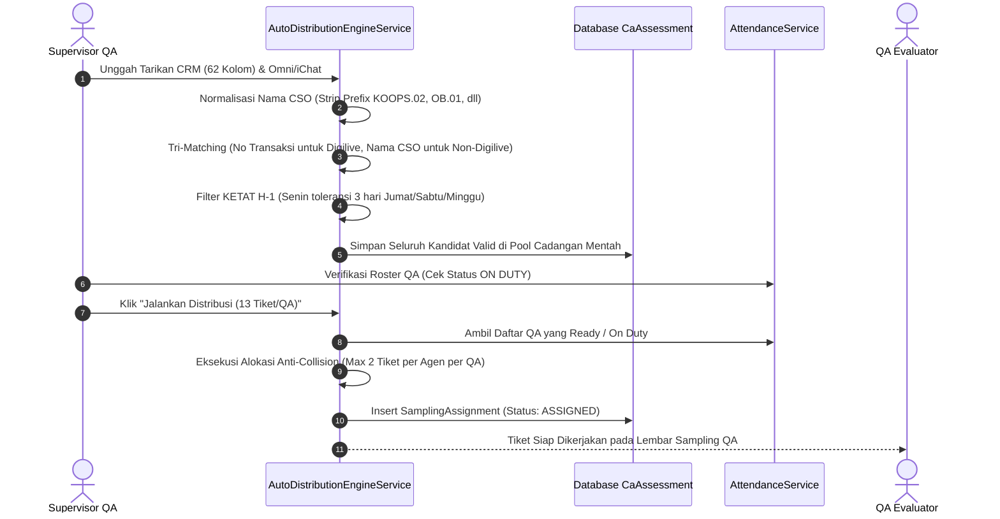
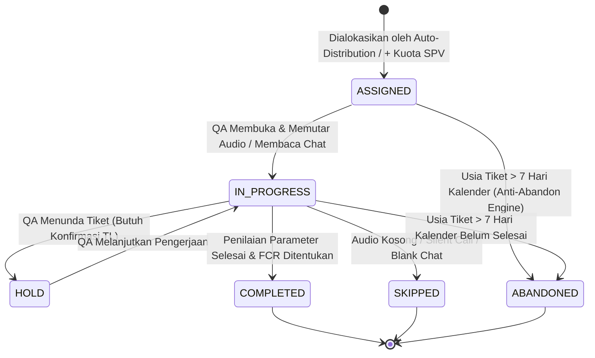

# 🛡️ DigiQA Enterprise (Q-Apps Contact Center Mutu v2.5)

<div align="center">

[](https://laravel.com)
[](https://react.dev)
[](https://vitejs.dev)
[](https://tailwindcss.com)
[](https://php.net)
[](https://mysql.com)
[]()

**Platform Tata Kelola Mutu Contact Center Terpadu, Analitik Performa Agen, Mesin Auto-Distribusi Sampling Cerdas, dan Manajemen Kedisiplinan SLA**

[📘 Spesifikasi Fungsional (FRD)](file:///c:/xampp/htdocs/digiQa/FRD.md) • [📖 Buku Panduan Manual Book](file:///c:/xampp/htdocs/digiQa/FLOWAPPS_MANUAL_BOOK_PANDUAN_OPERASIONAL.md) • [⚡ Panduan Cepat Menjalankan](#-panduan-cepat-instalasi--menjalankan) • [🔐 Akun Default](#-akun-default--hak-akses-rbac)

</div>

---

## 🌟 Highlight Fitur Utama DigiQA v2.5

```
┌─────────────────────────────────────────────────────────────────────────────────────────────┐
│ 🎯 ATURAN BAKU KETAT H-1 (STRICT H-1 RULE)                                                  │
│ Menjamin transaksi sampling selalu relevan: wajib tepat H-1 untuk hari biasa (Selasa–Minggu)│
│ dan toleransi akhir pekan maksimal 3 hari (Jumat, Sabtu, Minggu) khusus hari Senin.         │
├─────────────────────────────────────────────────────────────────────────────────────────────┤
│ 🔍 TRI-MATCHING ENGINE V2 (iCRM vs. OMNI vs. iCHAT)                                         │
│ Pencocokan presisi multi-sumber: acuan Nomor Transaksi untuk Digilive, acuan Nama CSO       │
│ NAKER untuk Non-Digilive, validasi time-window, dan eliminasi tiket unmatched otomatis.     │
├─────────────────────────────────────────────────────────────────────────────────────────────┤
│ 🔒 PROTOKOL KEAMANAN BLIND AUDIT                                                            │
│ Melindungi integritas penilaian mutu: identitas QA Evaluator disamarkan otomatis menjadi   │
│ "QA Evaluator (Terproteksi)" pada antarmuka TL, Trainer, dan CSO serta respon API backend.  │
├─────────────────────────────────────────────────────────────────────────────────────────────┤
│ ⚖️ KUSTOMISASI INDEPENDEN 7 LAYANAN & 4 KATEGORI                                           │
│ Supervisor bebas menentukan kuota harian layanan (misal 10) & kategori (misal 13) tanpa     │
│ gangguan auto-rebalancing yang mengubah nilai lain secara otomatis.                         │
├─────────────────────────────────────────────────────────────────────────────────────────────┤
│ ⏱️ AUDIT KEDISIPLINAN SLA 7 HARI & ANTI-ABANDON                                             │
│ Mesin otomatis membatalkan dan mengunci tiket yang tidak selesai dinilai dalam 7 hari kerja.│
├─────────────────────────────────────────────────────────────────────────────────────────────┤
│ ☁️ BACKUP ENGINE OTOMATIS KE GOOGLE DRIVE                                                   │
│ Otomatisasi pencadangan database dan berkas ke Google Drive (OAuth2 & Service Account).     │
└─────────────────────────────────────────────────────────────────────────────────────────────┘
```

---

## 🧭 Prinsip Arsitektur Utama (Separation of Data Pipeline)

DigiQA memisahkan secara tegas dua jalur pemrosesan data (*Strict Separation of Data*):

```mermaid
flowchart TD
    subgraph Pipeline_Harian ["🔄 1. Pipeline Operasional Harian (Data Mentah / Raw)"]
        CRM["Tarikan CRM Mentah (Excel 62 Kolom)"] -->|Upload Pagi < 07:00 WIB| M9["Modul 9: Auto Distribution (SPV)"]
        OMNI["Tarikan Summary Omni & iChat"] --> M9
        M9 -->|Engine V2: Tri-Matching & H-1| Bucket["Antrean Kerja QA (Locker Anti-Collision)"]
        M9 -->|Sisa Ribuan Tiket| Pool[(Pool Cadangan Mentah)]
        Bucket -->|Observasi SOP & FCR| M6["Modul 6: Lembar Sampling QA"]
        Pool -->|Otorisasi 24 Jam| Extra["+ Kuota SPV"]
        Extra --> Bucket
        M6 -->|Hasil Evaluasi Harian| Evaluated["Tiket Selesai Dinilai (COMPLETED)"]
    end

    subgraph Pipeline_Bulanan ["📊 2. Pipeline Dasbor Eksekutif (Data Matang / Processed)"]
        NAKER["Master Database NAKER (Plotting)"] -->|Awal Bulan| M10["Modul 10: Input & Data Master"]
        QSF["File Rekapitulasi QSF 7 Saluran"] -->|Awal Bulan| M10
        M10 -->|Agregasi Database Mutu| DB[(Database Mutu Resmi CA & FCR)]
        DB --> M1["Modul 1: Dashboard Global (KPI CA & FCR)"]
        DB --> M2["Modul 2: Anev Ranking (Top & Bottom CSO)"]
        DB --> M3["Modul 3: Agent Scorecards (Lembar Nilai)"]
        DB --> M4["Modul 4: Success Board (Pencapaian QA 370 Sesi)"]
    end

    subgraph Modul_Khusus ["👥 3. Tata Kelola & Pendukung"]
        M5["Modul 5: Policy Hub (SOP & Kalibrasi)"]
        M7["Modul 7: Real Monitoring (Live Coaching & Eliminasi)"]
        M8["Modul 8: Under Team Rekap (Portal TL & Trainer)"]
        M11["Modul 11: Kelola Akun (Injeksi Akun NAKER)"]
        M12["Modul 12: Google Drive Backup Engine"]
    end
```



> [!IMPORTANT]
> **Aturan Pemisahan Mutlak**: Data mentah dari Auto-Distribution tidak pernah langsung diproyeksikan ke Dashboard Global (Modul 1–4). Dashboard eksekutif murni mengagregasi data matang QSF yang telah selesai dievaluasi penuh selama satu bulan.

---

## 📑 Daftar Isi Interaktif

- [🏛️ Struktur Modul & Navigasi RBAC](#-struktur-modul--navigasi-rbac)
- [⚙️ Spesifikasi & Alur Kerja Sub-Sistem](#️-spesifikasi--alur-kerja-sub-sistem)
- [📊 Matriks Parameter SOP 7 Saluran Layanan](#-matriks-parameter-sop-7-saluran-layanan)
- [🛠️ Arsitektur Teknologi & Dependensi](#️-arsitektur-teknologi--dependensi)
- [📂 Struktur Direktori Repositori](#-struktur-direktori-repositori)
- [⚡ Panduan Cepat Instalasi & Menjalankan](#-panduan-cepat-instalasi--menjalankan)
- [🐳 Panduan Menjalankan dengan Docker](#-panduan-menjalankan-dengan-docker)
- [🔐 Akun Default & Hak Akses (RBAC)](#-akun-default--hak-akses-rbac)
- [📚 Dokumen Resmi Terkait](#-dokumen-resmi-terkait)

---

## 🏛️ Struktur Modul & Navigasi RBAC

Sistem mengimplementasikan otorisasi ketat berbasis Role-Based Access Control (RBAC):

| No | Modul | Rute URL | Akses Peran | Tanggung Jawab Operasional |
|:---:|:---|:---|:---:|:---|
| **0** | **Autentikasi & Profil** | `/login`, `/me` | Semua | Login, refresh sesi token, heartbeat daemon, ganti password mandiri. |
| **1** | **Dashboard Global** | `/dashboard-global` | Semua | Monitoring makro mutu Site: Skor **CA (Target ≥ 85%)**, **FCR (Target 100%)**, tren Jan–Des, performa 7 kanal, dan 5 parameter kegagalan terendah. |
| **2** | **QA Analytics (Anev)** | `/anev` | Semua | Analisis & Evaluasi ranking: Top 5/10 High Performers, Bottom 5/10 Low Performers, deviasi parameter, dan rekomendasi coaching. |
| **3** | **Agent Scorecards** | `/rekap-agent` | Semua | Rekapitulasi nilai per sesi agen, rincian parameter, filter TL/Trainer, ekspor **Excel (.xlsx)** & **Cetak PDF** lembar observasi *(Blind Audit applied)*. |
| **4** | **Success Board** | `/pencapaian-qa` | Semua | Pelacakan realisasi kuota bulanan per QA (**Target: 370 sesi/bulan**) dan Trainer, run-rate harian, dan grafik pencapaian. |
| **5** | **QA Policy Hub** | `/kebijakan` | Semua | *Knowledge base* regulasi SOP, notulensi rapat kalibrasi berkala, tanya-jawab parameter mutu, dan materi pembinaan. |
| **6** | **Lembar Sampling QA** | `/evaluasi-sampling` | QA, SPV | Lembar kerja evaluasi: pemutar audio call, transkrip chat, checklist parameter SOP, penentuan FCR, status Hold/Skip, dan tombol request kuota. |
| **7** | **Real Monitoring** | `/real-monitoring` | QA, SPV | Observasi langsung (*live listening* / *side-by-side*) dengan eliminasi silang otomatis ke antrean sampling agar agen tidak dinilai ganda. |
| **8** | **Under Team Rekap** | `/rekap-under-team` | TL, Trainer, SPV | Portal monitoring tim binaan bagi Team Leader dan Trainer dengan penyamaran nama QA Evaluator (*Blind Audit Protocol*). |
| **9** | **Auto Distribution** | `/auto-distribution` | **Khusus SPV** | Mesin Auto-Distribusi V2: upload CRM 62 kolom, Tri-Matching, Strict H-1, roster kehadiran QA On Duty, pool cadangan, dan `+ Kuota SPV`. |
| **10**| **Data Master & Import** | `/settings` | **Khusus SPV** | Pintu masuk data matang: import plotting Master NAKER, import QSF 7 saluran, input manual ad-hoc, setup formula, dan reset data. |
| **11**| **Kelola Akun Pengguna** | `/kelola-akun` | **Khusus SPV** | Manajemen kredensial, otomatisasi pembuatan akun dari Master NAKER candidates, reset password, dan toggle status akun. |
| **12**| **Google Drive Backup** | `/backup-drive` | **Khusus SPV** | Manajemen pencadangan database & berkas terkompresi ke Google Drive via OAuth 2.0 atau Service Account. |

---

## ⚙️ Spesifikasi & Alur Kerja Sub-Sistem

<details>
<summary><b>▶ 1. Alur Auto Distribution Engine V2 & Tri-Matching</b> (Klik untuk membuka)</summary>



- **Prinsip Utama Tri-Matching**:
  - **Digilive (iChat)**: Mengacu **Nomor Transaksi iCRM**, BUKAN ID Pelanggan!
  - **Non-Digilive (Inbound/Email/Sosmed/BO)**: Mengacu **Nama CSO NAKER**, BUKAN ID Pelanggan!
  - **Sub-kategori**: Diambil otoritatif dari iCRM (`namaKondisi`).
  - **Kategori**: Dipetakan secara baku ke 4 kategori: Informasi, Gangguan, Keluhan, Permohonan.
</details>

<details>
<summary><b>▶ 2. Alur Penilaian Lembar Sampling QA & Siklus Tiket</b> (Klik untuk membuka)</summary>



- **Mekanisme Tambah Kuota (`+ Kuota SPV`)**:
  - Jika QA telah menyelesaikan kuota 13 tiket harian lebih awal, QA dapat mengajukan tiket ekstra melalui tombol `+ Ajukan Kuota`.
  - Supervisor menyetujui penambahan kuota (+5, +10, +15 tiket) yang diambil langsung dari **Pool Cadangan Mentah**.
  - Tiket kuota ekstra memiliki penanda khusus `is_extra_quota = true` dan **masa berlaku 24 Jam (1 Hari)** untuk mencegah penumpukan antrean kerja.
</details>

<details>
<summary><b>▶ 3. Mekanisme Blind Audit Masking</b> (Klik untuk membuka)</summary>

Untuk menjaga independensi evaluasi dan objektivitas coaching:
- **Di Lapisan Backend (`AgentRecapController.php` & `SamplingDistributionController.php`)**:
  ```php
  $isBlindRole = in_array(strtolower($authUser->role), ['team_leader', 'tl', 'trainer', 'trn', 'agent', 'cso']);
  if ($isBlindRole && $assignment->evaluator_name !== $authUserName) {
      $assignment->evaluator_name = 'QA Evaluator (Terproteksi)';
  }
  ```
- **Di Seluruh Ekspor File (Excel & PDF)**: Kolom nama evaluator otomatis tertulis `Terproteksi (Blind Audit)`.
- Hanya Supervisor, Superadmin, dan QA Evaluator yang menilai tiket tersebut yang dapat melihat identitas aslinya.
</details>

---

## 📊 Matriks Parameter SOP 7 Saluran Layanan

Setiap saluran memiliki total bobot tepat **100 Poin**:

```
┌──────────────────┬──────────────┬───────────────┬────────────────────────────────────────────────────────┐
│ Kanal Layanan    │ Jumlah Param │ Total Bobot   │ Parameter Kunci                                        │
├──────────────────┼──────────────┼───────────────┼────────────────────────────────────────────────────────┤
│ 1. DIGILIVE      │ 18 Parameter │ 100 Poin      │ Salam Standar, Probing Terstruktur, Verifikasi Data,   │
│    (iChat/MyIcon)│              │               │ Etika & Empati, Solusi Akurat, Pencatatan CRM.         │
├──────────────────┼──────────────┼───────────────┼────────────────────────────────────────────────────────┤
│ 2. INBOUND CALL  │ 14 Parameter │ 100 Poin      │ Salam Pembuka, Verifikasi, Probing, Intonasi/Kejelasan,│
│    (Telepon 123) │              │               │ Magic Words, Akurasi Solusi, Akad Transaksi.           │
├──────────────────┼──────────────┼───────────────┼────────────────────────────────────────────────────────┤
│ 3. EMAIL INBOUND │ 15 Parameter │ 100 Poin      │ Sapa Nama, Identifikasi No Tiket, Validasi Data,       │
│                  │              │               │ Tata Penulisan Respons, Solusi Tuntas, Info Kanal Lain.│
├──────────────────┼──────────────┼───────────────┼────────────────────────────────────────────────────────┤
│ 4. SOSIAL MEDIA  │ 8 Parameter  │ 100 Poin      │ Sapa Nama Akun, Kreativitas Kalimat, Menyimak Kritis,  │
│    (DM / Mention)│              │               │ Solusi Lengkap, Empati, Kemampuan Menulis.             │
├──────────────────┼──────────────┼───────────────┼────────────────────────────────────────────────────────┤
│ 5. OUTBOUND CALL │ 12 Parameter │ 100 Poin      │ Salam, Verifikasi, Kemampuan Negosiasi / Konfirmasi,   │
│    (OBC)         │              │               │ Etika Komunikasi, Kelengkapan Informasi Solusi.        │
├──────────────────┼──────────────┼───────────────┼────────────────────────────────────────────────────────┤
│ 6. EMAIL OUTBOUND│ 15 Parameter │ 100 Poin      │ Kepatuhan Hubungi 3x Telepon, Penulisan Email,         │
│                  │              │               │ Validasi Data, Konfirmasi Laporan, Kesesuaian CRM.     │
├──────────────────┼──────────────┼───────────────┼────────────────────────────────────────────────────────┤
│ 7. BACK OFFICE   │ 3 Parameter  │ 100 Poin      │ Kesesuaian Analisa (40 Poin), Kesesuaian Pencatatan &  │
│    (BO Escalation│              │               │ Eskalasi (40 Poin), Penggunaan Kalimat (20 Poin).      │
└──────────────────┴──────────────┴───────────────┴────────────────────────────────────────────────────────┘
```

---

## 🛠️ Arsitektur Teknologi & Dependensi

### Frontend Architecture
- **Framework**: [React 18.2](https://react.dev/) + [Vite 5.4](https://vitejs.dev/)
- **Routing**: [React Router DOM v6](https://reactrouter.com/) dengan RBAC Route Guards
- **UI Styling**: [Tailwind CSS 3.4](https://tailwindcss.com/) dengan Custom Corporate Design System
- **Komponen Ikon**: [Lucide React](https://lucide.dev/)
- **Visualisasi Data**: [Recharts 2.x](https://recharts.org/)
- **Ekspor Dokumen**: [SheetJS (xlsx)](https://sheetjs.com/) & [jsPDF](https://github.com/parallax/jsPDF) + [html2canvas](https://html2canvas.hertzen.com/)
- **Manajemen Dialog**: Custom in-DOM Confirm/Alert/Toast context modal

### Backend RESTful API Architecture
- **Framework**: [Laravel 11.x](https://laravel.com/) (PHP 8.2+)
- **ORM**: Eloquent ORM dengan relasi penuh dan chunk processing
- **Autentikasi**: Laravel Sanctum (Token-based Session Auth via Cookies)
- **Komunikasi Real-Time**: Server-Sent Events (SSE) `/api/realtime/stream`
- **Pencadangan Cloud**: Google API Client (`google/apiclient`) untuk Google Drive V3 Integration
- **Ekspor Server**: `maatwebsite/excel` (Sheet multi-tab export)

---

## 📂 Struktur Direktori Repositori

```text
digiQa/
├── backend/                             # RESTful API Backend (Laravel 11)
│   ├── app/
│   │   ├── Http/Controllers/Api/        # Dashboard, SamplingDistribution, Auth, Backup, dll.
│   │   ├── Models/                      # CaAssessment, SamplingAssignment, Employee, dll.
│   │   └── Services/
│   │       ├── Sampling/                # Engine V2: AutoDistribution, Roster, NakerVerification
│   │       └── QsfImportService.php     # Engine Impor QSF 7 Kanal
│   ├── database/
│   │   ├── migrations/                  # 30+ File Migrasi Skema Database Mutu
│   │   └── seeders/                     # Seeder Akun Utama & Master Data Awal
│   └── routes/api.php                   # Katalog Rute API RESTful (190+ Endpoints)
│
├── frontend/                            # Client SPA Application (React 18 + Vite)
│   ├── src/
│   │   ├── components/
│   │   │   ├── common/                  # CustomSelect, ErrorBoundary, SupervisorReminder
│   │   │   └── layout/                  # Navbar, Sidebar (RBAC Filtered), MobileNav
│   │   ├── context/                     # AuthContext, DialogContext, SyncContext
│   │   ├── pages/                       # 13 Halaman Modul Lengkap
│   │   │   ├── AutoDistribution.jsx     # Modul 9: Mesin Auto-Distribusi
│   │   │   ├── QASamplingWorksheet.jsx  # Modul 6: Lembar Sampling QA
│   │   │   ├── SupervisorInput.jsx      # Modul 10: Satu Pintu Data Master
│   │   │   └── ...                      # GlobalDashboard, Anev, AgentRecap, dll.
│   │   └── services/api.js              # Jembatan Axios REST Client
│
├── FRD.md                               # Functional Requirements Document Resmi (832 Baris)
├── FLOWAPPS_MANUAL_BOOK_PANDUAN_OPERASIONAL.md # Buku Panduan Operasional Lengkap
├── docker-compose.yml                   # Orkestrasi Kontainer Docker (App, Webserver, DB)
├── run_digiqa.bat                       # Script 1-Klik Otomatis (Windows)
├── start_backend.bat                    # Script Menjalankan Laravel Server (Port 8000)
├── start_frontend.bat                   # Script Menjalankan Vite Server (Port 5173)
└── stop_digiqa.bat                      # Script Menghentikan Seluruh Servis
```

---

## ⚡ Panduan Cepat Instalasi & Menjalankan

### Persyaratan Minimal:
- **PHP** >= 8.2 (Ekstensi: `pdo_mysql`, `mbstring`, `fileinfo`, `zip`, `curl`, `gd`)
- **Composer** (PHP Package Manager)
- **Node.js** >= 18.x & **NPM**
- **MySQL / MariaDB** (Port 3306)

---

### Cara 1: Eksekusi 1-Klik di Windows (Paling Cepat)
Cukup jalankan file batch pada root direktori:
```cmd
run_digiqa.bat
```
Script otomatis memvalidasi MySQL, menjalankan backend di `http://127.0.0.1:8000`, dan membuka browser frontend di `http://127.0.0.1:5173`.

Untuk mematikan seluruh servis:
```cmd
stop_digiqa.bat
```

---

### Cara 2: Instalasi Manual Langkah Demi Langkah

#### 1. Konfigurasi Backend (Laravel 11)
```bash
cd backend
composer install
cp .env.example .env
php artisan key:generate
```

Sesuaikan koneksi database di file `backend/.env`:
```env
DB_CONNECTION=mysql
DB_HOST=127.0.0.1
DB_PORT=3306
DB_DATABASE=qa_db
DB_USERNAME=root
DB_PASSWORD=
```

Jalankan migrasi database dan jalankan server:
```bash
php artisan migrate --seed
php artisan serve --port=8000
```

#### 2. Konfigurasi Frontend (React + Vite)
Buka terminal baru:
```bash
cd frontend
npm install
npm run dev
```
Buka browser: **`http://127.0.0.1:5173`**.

---

## 🐳 Panduan Menjalankan dengan Docker

Sistem telah dilengkapi konfigurasi Docker lengkap:

```bash
# 1. Jalankan seluruh container (Backend, Frontend, MySQL)
docker-compose up -d --build

# 2. Jalankan migrasi di dalam container
docker-compose exec backend php artisan migrate --seed

# 3. Akses aplikasi:
# - Frontend: http://localhost:5173 (atau port 80/8080 sesuai compose)
# - Backend API: http://localhost:8000/api/health
```

---

## 🔐 Akun Default & Hak Akses (RBAC)

| Peran (Role) | Username Default | Password | Akses Menu Utama |
|:---|:---|:---|:---|
| **Supervisor QA** | `supervisor` | `password` | Akses Penuh: Auto-Distribution, Data Master, Kelola Akun, Backup Drive, Reset Data. |
| **QA Evaluator** | `qa` / `[nama.qa]` | `password` | Dashboard 1–4, Policy Hub (5), dan **Lembar Sampling QA (6)**. |
| **Team Leader (TL)**| `team_leader` | `password` | Dashboard 1–4, Policy Hub (5), dan **Rekap Tim Binaan (8)** *(Blind Audit)*. |
| **Trainer QA** | `trainer` | `password` | Dashboard 1–4, Policy Hub (5), dan **Rekap Kelas Bimbingan (8)** *(Blind Audit)*. |
| **Superadmin** | `admin` | `password` | Hak Akses Tertinggi Sistem dan Audit Teknis. |

---

## 📚 Dokumen Resmi Terkait

- 📄 **[Functional Requirements Document (FRD)](file:///c:/xampp/htdocs/digiQa/FRD.md)**: Dokumen spesifikasi kebutuhan fungsional 832 baris lengkap dengan ERD, kamus data, dan katalog API.
- 📘 **[Buku Panduan Operasional (Manual Book)](file:///c:/xampp/htdocs/digiQa/FLOWAPPS_MANUAL_BOOK_PANDUAN_OPERASIONAL.md)**: Panduan detail proses bisnis harian dan bulanan bagi SPV, QA, dan TL.
- ☁️ **[Panduan Koneksi Google Drive Backup](file:///c:/xampp/htdocs/digiQa/PANDUAN_KONEKSI_GOOGLE_DRIVE_BACKUP.md)**: Panduan konfigurasi OAuth2 dan Service Account Google Drive.
- 🐳 **[Docker Deployment Guide](file:///c:/xampp/htdocs/digiQa/DOCKER_DEPLOYMENT_GUIDE.md)**: Panduan kontainerisasi lingkungan staging dan production.

---

<div align="center">

*Diterbitkan secara resmi oleh Tim Tata Kelola Mutu & IT Contact Center DigiQA Enterprise.*  
*Hak Cipta © 2026 DigiQA System. Seluruh hak cipta dilindungi undang-undang.*

</div>
